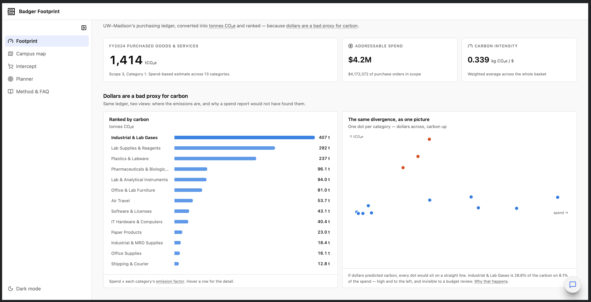
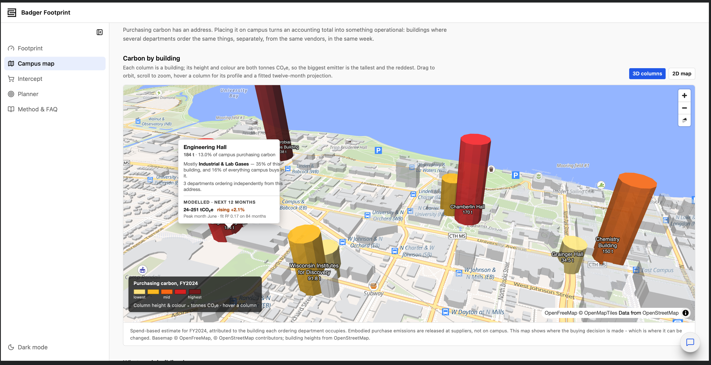
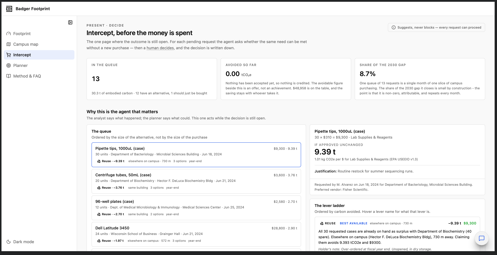
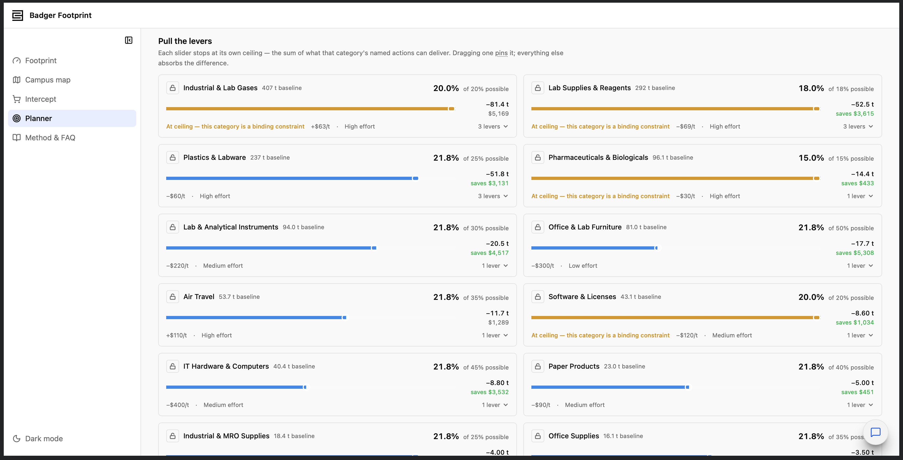

# Badger Footprint

**Spend-based Scope 3 carbon analytics for UW–Madison purchasing** — built for the C3 AI Accelerator Hackathon.

Badger Footprint converts the university's purchasing ledger into tonnes of CO₂e, shows where that carbon sits on campus, intercepts pending purchase requests while the decision is still open, and plans a path to UW–Madison's published reduction goals (20% by 2030, 45% by 2040, 95% by 2048).

The core idea: **dollars are a bad proxy for carbon.** Industrial & Lab Gases is 28.8% of the carbon on just 8.1% of the spend — invisible to a budget review.



## The four pages

Navigation runs past → present → future.

### Footprint — where the carbon is
FY2024 purchased goods & services come to **1,414 tCO₂e** across $4.2M of in-scope spend and 13 categories. Categories are ranked by carbon and plotted against spend to show how badly the two diverge.

### Campus map — the same footprint on the ground
Each building is a 3D column whose height and colour are its tonnes CO₂e (MapLibre GL over OpenFreeMap / OpenStreetMap, with a 2D Leaflet fallback). Hovering a building shows its share of campus carbon, dominant category, number of departments ordering independently, and a fitted 12-month projection.



### Intercept — before the money is spent
Every pending purchase request is scored at decision time against a lever ladder: **reuse** surplus stock elsewhere on campus → **substitute** a cleaner product → **consolidate** with other orders → **defer** fiscal-year-end over-ordering. The agent suggests, never blocks: a human decides, and the decision (including a refusal) is recorded.

On the seeded queue, 13 requests carrying 30.3 t would avoid **24.5 t (80.8%) and $48,958** if every top recommendation were taken. The biggest single win is a case of pipette tips (9.4 t), not the 24-laptop refresh (2.0 t) — which is the whole argument.



### Planner — pull the levers
A deterministic goal-seeking solver. Each category slider stops at its own ceiling (the sum of that category's named reduction levers); pinning one redistributes the rest. Strategies: equal %, cheapest-first (a MACC applied rather than drawn), and effort-balanced. Infeasible targets are reported honestly with the shortfall and ranked remedies.



There is also a **Method & FAQ** page covering the factor table, a worked example, what is real vs modelled vs assumed, known weaknesses, and a 21-entry glossary.

## Architecture

```
React UI (Vite + C3 Design System)
        │  c3Action
        ▼
BadgerCopilot  ── tool-calling LLM loop: 14 tools (12 read, 2 confirm-gated writes)
        │
        ├── BadgerAnalytics   Agent 1 · insight       campusSummary, emissionsBy, emissionsTrend, hotspots, buildingMap
        ├── InterceptAgent    Agent 2 · intercept     queue, evaluate, decide, interceptStats
        ├── PlannerAgent      Agent 3 · what-if       baseline, solve, savePlan
        └── ForecastAgent     Agent 4 · projection    buildingForecast, allBuildingForecasts
        │
        ▼
C3 entity types  (EmissionFactor, SpendTransaction, Vendor, Building, Department, ReductionLever, …)
```

- **Every displayed figure comes from an agent.** No page computes carbon itself.
- **Bucky**, the copilot, is a floating chat available on every page. It decides at runtime which agent methods to call and chains them — e.g. *"which building emits the most, and is there spare stock there?"* runs `emissionsBy` → `intercept_queue` → `intercept_evaluate`. On the Planner it moves the sliders directly.
- **Grounding rule:** every number the copilot states comes from a tool result; answers without a tool call are labelled *unverified*. Writes (`intercept_decide`, `planner_savePlan`) are never executed automatically — they come back for a human to confirm.
- **Measured vs projected are kept apart.** `ForecastAgent` fits a per-building OLS regression (trend + month-of-year dummies) with 95% prediction intervals; its output is always labelled as projected and never summed into a measured total.

**Carbon math:** `tonnes CO₂e = amount × emissionFactor.kgCo2ePerDollar / 1000`

## Data

| Source | Status |
| --- | --- |
| EPA USEEIO Supply Chain GHG Emission Factors v1.3 (kg CO₂e per $ by NAICS) | **Real** |
| UW–Madison 2030 / 2040 / 2048 reduction targets | **Real** |
| Building names and campus coordinates | **Real** |
| Product footprints (e.g. Dell, Apple reports) | **Real** where cited |
| Transactions, departments, vendors, contracts, inventory, pending requests, levers | **Representative** — synthetic, built to realistic magnitudes; the transaction schema matches OpenBook Wisconsin |

See [dataset/DATA_SOURCES.md](dataset/DATA_SOURCES.md) for full provenance. Swapping in a real OpenBook Wisconsin export requires no schema changes.

## Repository layout

```
dataset/                 Raw CSVs + XLSX and data provenance notes
pkgf994ca4b/
  src/                   C3 types (.c3typ) and agent implementations (.js)
  data/                  Seed data for each entity type (JSON)
  ui/react/              React + TypeScript front end (Vite)
    src/pages/           Overview, CampusMap, Intercept, Planner, Methodology
    src/api/             badger.ts (agent calls), copilot.ts (Bucky)
    src/components/badger/  App-specific components (charts, sliders, Bucky dock)
screenshots/             App screenshots used in this README
```

More implementation detail is in [pkgf994ca4b/src/WORKSPACE_SUMMARY.md](pkgf994ca4b/src/WORKSPACE_SUMMARY.md).

## Running the UI

Requires Node.js 20.18+ and npm 10+, plus a C3 environment with the `pkgf994ca4b` package deployed.

Create `pkgf994ca4b/ui/react/.env`:

```
VITE_C3_ENV=<env_name>
VITE_C3_APP=<app_name>
VITE_C3_URL=<cluster_url>
VITE_C3_AUTH_TOKEN=<auth_token>
```

Then:

```bash
cd pkgf994ca4b/ui/react
npm install
npm run dev      # local dev server
npm run build    # lint + typecheck + production build
npm test         # jest
```

See [pkgf994ca4b/ui/react/README.md](pkgf994ca4b/ui/react/README.md) for how to get the auth token and other setup notes.
